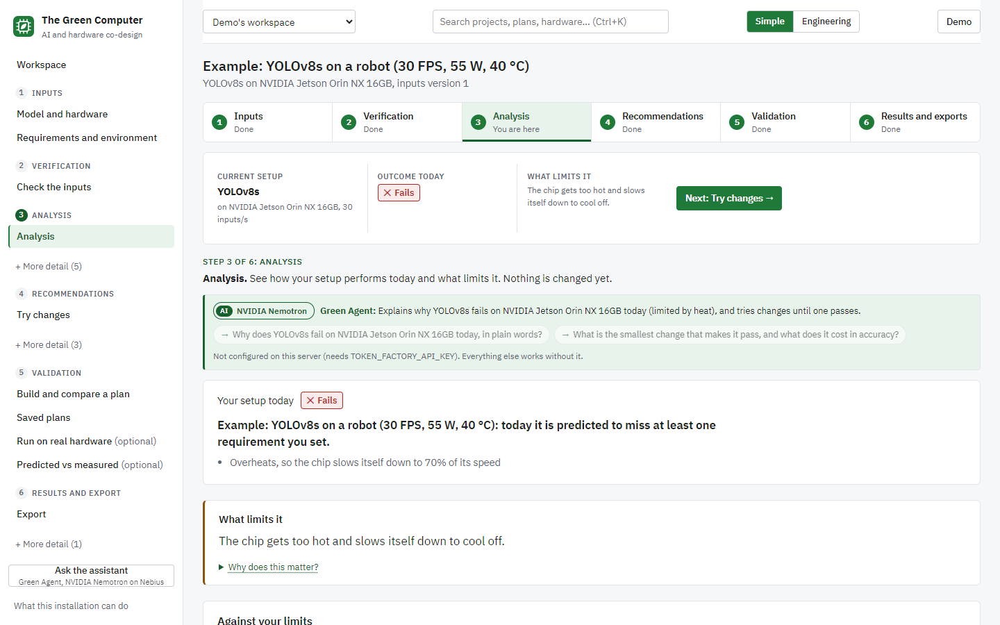
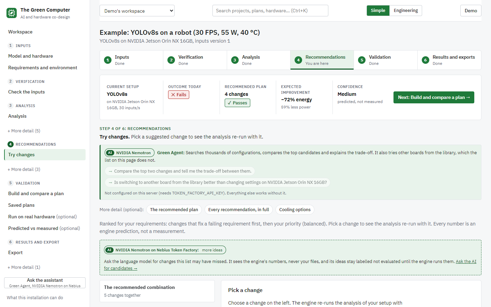
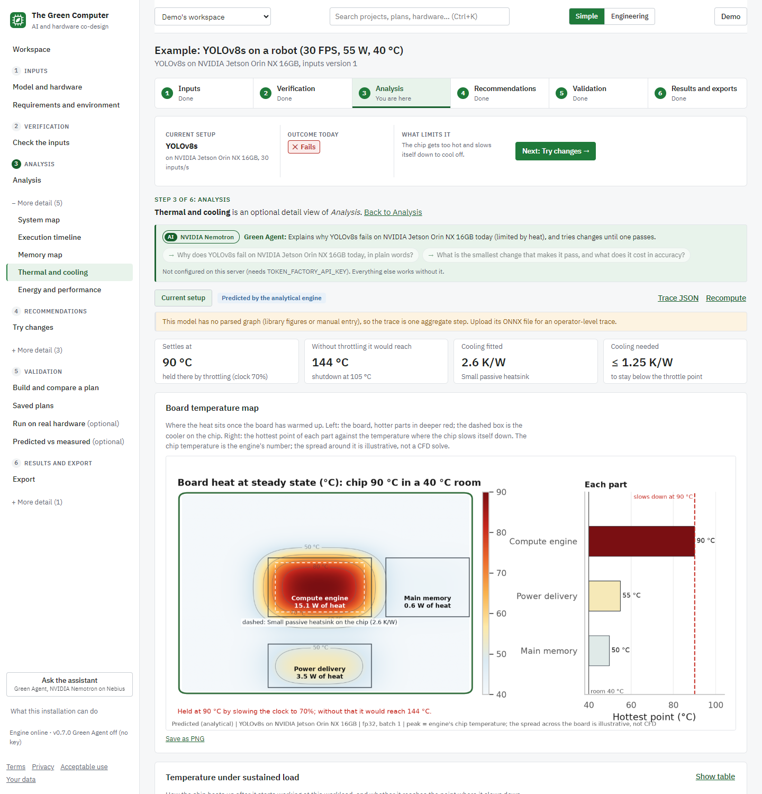
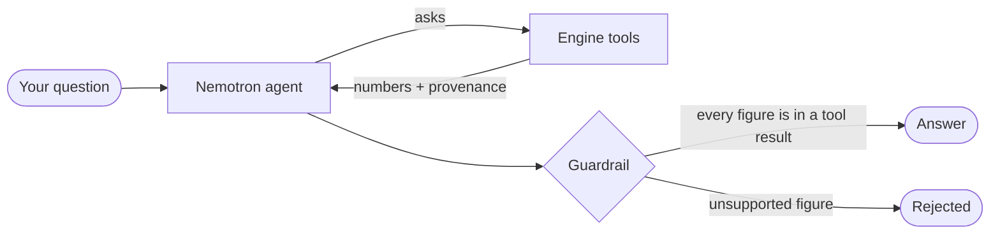
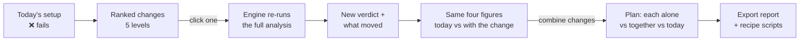
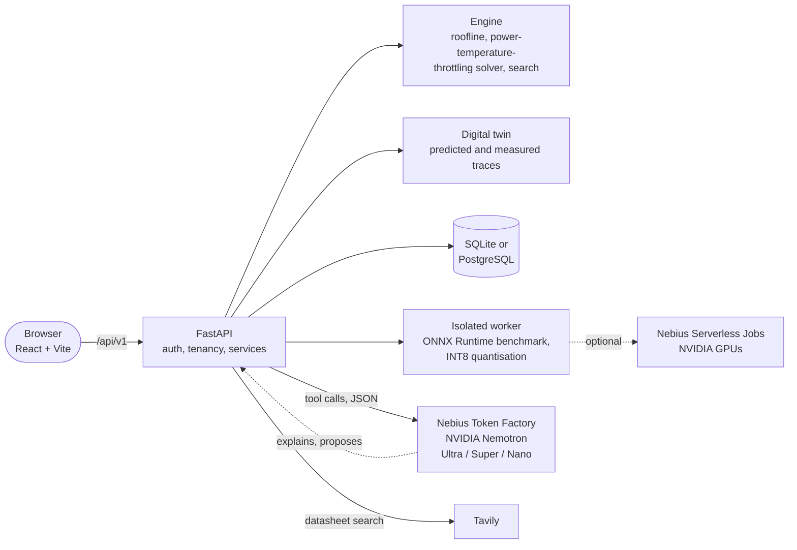

<div align="center">


# The Green Computer

## ***"The Sustainable Tech of 21st Century"***

**See how an AI model will run on your hardware, before you build it.**<br>
Predict latency, power, heat, throttling, cost and carbon. Get ranked fixes. Verify. Export.

[](https://green-computer-7yy6xwxdna-ue.a.run.app)

[](LICENSE)
[](#built-on-nvidia-nemotron-and-nebius-token-factory)
[](#built-on-nvidia-nemotron-and-nebius-token-factory)
[](#services-used)


**[Try it live](https://green-computer-7yy6xwxdna-ue.a.run.app)** ·
**[Two-minute tour](docs/demo-guide.md)** ·
**[Architecture](docs/architecture.md)** ·
**[Run it yourself](#run-it-yourself)**

*Nebius x NVIDIA Global AI Hackathon, Best Apps and Agents track*

</div>

---

## Contents

[The problem](#the-problem) · [See it](#see-it) · [Try it live](#try-it-live-in-two-minutes) ·
[Nemotron and Token Factory](#built-on-nvidia-nemotron-and-nebius-token-factory) ·
[Why it is different](#why-it-is-different) · [Innovation](#why-it-is-innovative) · [Recommendations](#recommendations-see-the-impact-of-every-change) · [Features](#features) · [How it works](#how-it-works) ·
[Run it yourself](#run-it-yourself) · [Tests](#tests) · [Status](#what-is-and-is-not-verified) ·
[Tech stack](#tech-stack) · [Licence](#licence)

## The problem

> [!IMPORTANT]
> Teams put AI on robots, cameras and edge boards, then discover **too late** that the model
> overheats, throttles itself, blows the power budget or sits on the wrong board. Fixing it means
> weeks of trial and error across the model, the software and the hardware.

**The Green Computer shows it before anything is built.** The bundled example, a YOLOv8s detector on
a Jetson Orin NX at 30 inputs a second in a 40 °C room:

| | Today | With the recommended plan |
|---|:---:|:---:|
| **Verdict** | ❌ Fails | ✅ Passes every requirement |
| **Chip temperature** | 🔥 90 °C, throttles to ~70% speed | ❄️ within your limits |
| **Power** | baseline | **about 59% less** |
| **Energy per input** | baseline | **-72%** |

Then it exports a report and a recipe of scripts. Everything is vendor-neutral and runs fully
offline; NVIDIA GPUs, Nebius cloud jobs and the AI assistant are optional accelerators.

## See it

<table>
  <tr>
    <td width="50%"><a href="docs/images/02-analysis.png"></a><br><sub><b>1. Analyse today's setup.</b> A plain verdict, what limits it, and the numbers against your limits.</sub></td>
    <td width="50%"><a href="docs/images/03-recommendations.png"></a><br><sub><b>2. Try ranked changes.</b> The engine re-runs everything with each one: -72% energy, 59% less power.</sub></td>
  </tr>
  <tr>
    <td colspan="2"><a href="docs/images/04-thermal.png"></a><br><sub><b>3. See why.</b> Board heat map: the compute engine reaches 90 °C and slows itself down to cool off.</sub></td>
  </tr>
</table>

<sub>Screenshots are from a local copy running without a Token Factory key, so the Green Agent box
says it is not configured. In the hosted demo it is on.</sub>

## Try it live in two minutes

Open **[green-computer-7yy6xwxdna-ue.a.run.app](https://green-computer-7yy6xwxdna-ue.a.run.app)**
(free, no payment, no email confirmation), then:

1. **Sign up** and open **Example: YOLOv8s on a robot (30 FPS, 55 W, 40 °C)**.
2. **Analyse.** Today's setup fails: the Jetson Orin NX overheats and throttles to about 70% of its speed.
3. **Recommendations.** Click **Start with the top-ranked change**; the engine re-runs everything with it.
4. **Validation.** Build a plan: it meets every requirement with about 59% less power.
5. **Ask the assistant** (sidebar): Nemotron answers by calling the engine, and every figure is checked.
6. **Datasheet import** (Inputs > Hardware, "Your hardware isn't in the list?"): try "Hailo-8L".
7. **Export** the report and the recipe.

## Built on NVIDIA Nemotron and Nebius Token Factory

The deterministic engine computes every number. **NVIDIA Nemotron models, called at run time through
the Nebius Token Factory inference API** (OpenAI-compatible, `TOKEN_FACTORY_API_KEY`), explain and
suggest. Each tier does the job it suits:

| Nemotron model | Job | Why that model | Code |
|---|---|---|---|
| **Nemotron 3 Ultra** | **Green Agent**: plans, calls the engine as tools, explains results | Multi-step reasoning and tool use | `backend/app/agent/` |
| **Nemotron 3 Super** | **AI candidates**: extra change ideas as schema-checked JSON | Mid-weight reasoning at lower cost | `backend/app/agent/recommender.py` |
| **Nemotron 3 Nano** | **Datasheet import**: reads specs from pages found by **Tavily** | Fast, cheap extraction | `backend/app/agent/datasheet.py`, `backend/app/integrations/tavily.py` |

### How the model is kept honest



| Guard | What it does |
|---|---|
| 🛡️ **Number guardrail** | Rejects any figure in a reply that is not in a tool result |
| 🔒 **Read-only requirements** | The agent cannot change your limits to make a result pass |
| 🧾 **Schema-checked candidates** | Unknown change ids lose their link, unsupported figures are removed, each is labelled *not evaluated* until the engine runs it |
| 👤 **Human confirmation** | Datasheet values arrive with their source page; a person confirms them |
| 🔌 **Live model matching** | Ids are matched against the provider's own list (`GC_MODEL_ULTRA`, `GC_MODEL_SUPER`, `GC_MODEL_NANO` override). All three are live in the [hosted demo](https://green-computer-7yy6xwxdna-ue.a.run.app) |

### Where Token Factory helped

| | Benefit | In practice |
|---|---|---|
| 🚀 | **No GPU needed to use Nemotron** | Built on a machine without an NVIDIA GPU; one OpenAI-compatible endpoint serves Ultra, Super and Nano to any laptop and the cloud demo |
| ⚖️ | **Right-sized models** | Ultra: tool-calling agent, ~1.4 s for a short reply. Super: six candidates in 12 to 21 s. Nano: whole search-and-extract datasheet import in 45 to 60 s (including Tavily) |
| 🔁 | **Swappable** | `TOKEN_FACTORY_BASE_URL` and `GC_MODEL_*` point the same code at any OpenAI-compatible endpoint; `scripts/check_nebius.py` checks chat and a tool-call round trip |

### Services used

| Service | Use | Status |
|---|---|---|
| Nebius Token Factory + NVIDIA Nemotron (Ultra, Super, Nano) | Agent, candidates, datasheet extraction | Live, verified 27 Oct 2026 |
| Tavily | Datasheet search for hardware not in the library | Live, verified 27 Oct 2026 |
| Nebius Serverless Jobs (NVIDIA GPUs) | Real benchmarks for calibration (`bench/`, `GC_ENABLE_NEBIUS=1`) | Built, not run live |
| Nebius Serverless Endpoints | Hosting the app ([deploy/endpoint.md](deploy/endpoint.md)) | Built, not run live |
| Google Cloud Run + Neon PostgreSQL | Hosts the public demo ([deploy/cloudrun/](deploy/cloudrun/README.md)) | Live |

Nebius Serverless Jobs and Endpoints are documented in [docs/connecting-nebius.md](docs/connecting-nebius.md)
and off by default (`GC_ENABLE_NEBIUS=0`).

## Why it is different

<table>
  <tr>
    <td width="25%" valign="top"><h3>📏 Honest numbers</h3>Every metric carries a <code>low..high</code> range and a source: analytical, calibrated, measured, vendor spec or assumed. Predictions are never shown as measurements.</td>
    <td width="25%" valign="top"><h3>🧮 The model never invents</h3>The language model explains and proposes. The engine decides, and every figure is traceable to a tool result.</td>
    <td width="25%" valign="top"><h3>🧭 One coherent path</h3>Inputs, verification, analysis, recommendations, validation, export: a numbered stepper, Back / Next on every page, example projects, light and dark themes.</td>
    <td width="25%" valign="top"><h3>🚧 Clear about gaps</h3>Unsupported inputs (schematic, PCB, RTL, netlist, assembly) get a "planned" message naming the format needed, never a fake success. Requirements are never loosened to pass.</td>
  </tr>
</table>

## Why it is innovative

Most tools answer one question about one layer: a profiler measures a model on hardware you already
own, a simulator models a chip, a spreadsheet adds up watts. The Green Computer closes the loop across
all of them **before the hardware exists**, in a single path.

| | Typical tools | **The Green Computer** |
|---|---|---|
| **When you learn about heat and throttling** | After you buy and run the board | Before: power, temperature and throttling are solved together |
| **Scope** | One layer: the model, or the runtime, or the chip | Model, software, hardware settings, board and cooling choice in one search |
| **What you get** | A number, or a dashboard | A verdict, the limiting factor, ranked fixes, and the re-analysed result of each |
| **Trust** | A single figure | A `low..high` range with provenance on every metric; predicted and measured never mixed |
| **Role of AI** | Often a chatbot that may invent figures | Nemotron explains and proposes; a guardrail rejects any number the engine did not compute |
| **Vendor lock-in** | Tied to one vendor's silicon | Vendor-neutral library of boards, MCUs, FPGAs and accelerators, or describe your own |
| **Outcome** | Insight | A report, a plan and a recipe of scripts you can act on |

What is new, in one line: **a co-design loop where a language model proposes ideas but a deterministic
physics engine evaluates every one of them, so each recommendation arrives with its own computed
before/after, not a guess.** (We make no claim that nothing similar exists anywhere; this is the
combination we built and verified, with its limits stated below.)

## Recommendations: see the impact of every change

Recommendations are the heart of the app. Nothing is suggested without being **evaluated**: click any
change and the engine re-runs the whole analysis with it applied, so you see the consequence on your
system, not a rule of thumb.



| Level | Example changes | What you see change |
|---|---|---|
| 🧠 **The AI model** | Quantise (FP16 / INT8), prune, smaller input, a lighter model | Energy, throughput, accuracy risk |
| ⚙️ **How it runs** | Batching, runtime options | Latency, throughput, memory |
| 🎛️ **Hardware settings** | Power mode, clocks | Power, temperature, throttling |
| 🔌 **Hardware or cooling** | Another board, a bigger heatsink or other cooling | Steady-state temperature, headroom |
| 💡 **Chip and board ideas** | Directional what-ifs, labelled as such | Direction of change only |

**What the impact view shows, for each change you try:**

- the **new verdict** (fails to passes, or what still fails and why),
- **what moves**: latency, energy per input, power, peak temperature, throttling, cost and carbon,
- the **same four figures side by side, today and with the change**: board heat map, warm-up curve,
  where the energy goes, and power over a batch,
- a **confidence level** and the range on every number.

In the bundled example the top-ranked plan turns a failing Jetson Orin NX into a pass with
**-72% energy and about 59% less power**, and the plan builder shows each change alone and all of
them together against today. Changes are ranked to fix failing requirements first, then your
priority, and each unit of engineering effort costs a little in the ranking so a physical change has
to earn its place. Requirements are never loosened to make a result pass.

## Features

<details open>
<summary><b>The six-step path</b></summary>

1. **Workspace.** Create an account; projects live in a private or a team workspace. Every change of
   inputs is a version; every analysis, plan, upload and export is in the project's history.
2. **Model and hardware.** Upload an ONNX model (validated, with a graph summary) or pick one of the
   library models; pick a board, MCU, FPGA or accelerator from the library or describe your own.
   Each hardware category lists exactly which files it accepts: device profiles (YAML/JSON, values
   may carry units), Vivado / ST Edge AI / Vela reports, power and telemetry logs, firmware ELF
   files, datasheets (read offline; scans go to OCR when installed, otherwise manual review).
3. **Constraints and environment.** Throughput, power, latency, memory and accuracy limits; ambient
   temperature, cooling, hours of use, electricity price and grid carbon; how it runs today.
4. **Analysis (of today's setup only).** The verdict, what limits it, the numbers against your
   limits, and four figures: a board heat map, the warm-up curve, where the energy goes and power
   over one batch. Optional detail views: **system map**, **execution timeline**, **memory map**,
   **thermal and cooling** and **energy and performance**.
5. **Recommendations: try changes.** Changes at five levels: the AI model, how it runs, hardware
   settings, hardware or cooling choice, and directional chip/board ideas, ranked for your
   requirements. Click one and the engine re-runs the analysis with it. Optionally ask Nemotron for
   more candidates; nothing it proposes is applied until the engine evaluates it.
6. **Validation and export.** Combine changes into a plan; the engine re-analyses today, each change
   alone and the combination. Run the model on the server's CPU (ONNX Runtime, isolated and
   time-limited) for measured latency; import measurements (bench JSON, CSV, nvidia-smi, tegrastats);
   compare predicted with measured. Export the report (Markdown, HTML, PDF), plan JSON, comparisons,
   traces, a hardware change specification, deployment configuration, recipe scripts, and an INT8
   ONNX model when quantisation runs and its outputs match the original.

</details>

<details>
<summary><b>Honesty rules</b></summary>

- Every number carries its range and its source. Predicted traces are labelled predicted; only real
  runs or imported logs are measured, and the two are never mixed.
- Exports are labelled *generated and validated*, *generated* or *template*. No changed PCB, RTL or
  chip-design file is ever produced; chip and board ideas are directional what-ifs.
- Accuracy effects of quantisation or pruning are priors with stated risk, never promises.
- The optional AI assistant cannot produce numbers; the engine computes all of them.

</details>

## How it works



The engine is pure and deterministic (no network, no LLM). The Nemotron layer sits beside it and can
only call it as a tool. The full description, with a status for each part, is in
[docs/architecture.md](docs/architecture.md).

<details>
<summary><b>Repository map</b></summary>

| Path | What is in it |
|---|---|
| `backend/app/engine/` | Physics, search and advice (pure, deterministic) |
| `backend/app/twin/` | Digital twin: execution trace, tensor lifetimes, memory timeline |
| `backend/app/agent/` | Nemotron on Token Factory: agent, recommender, datasheet import, guardrail |
| `backend/app/api/v1/`, `services/`, `db/`, `auth/` | API, orchestration, models, accounts and tenancy |
| `backend/app/execution/` | Isolated worker: benchmark, quantise, compare |
| `backend/app/migrations/` | Alembic revisions |
| `frontend/src/` | React app and hand-built SVG charts (`twin/chart.tsx`) |
| `frontend/e2e/` | Playwright browser journeys and accessibility checks |
| `bench/` | Benchmark scripts for GPU hosts (Nebius Serverless Jobs) |
| `deploy/`, `Dockerfile`, `docker-compose.yml` | Cloud Run, Nebius endpoint and compose deployment |
| `scripts/` | Dev start, acceptance, demo data, API docs |
| `docs/` | Architecture, API, security, assumptions, demo guide |

</details>

## Run it yourself

The hosted demo needs none of this. To run your own copy you need Python 3.11+ and Node.js 20+.

**Fastest:**
- **Windows:** double-click **`Start The Green Computer.bat`**.
- **macOS / Linux:** `./start.sh`

It creates the environment, builds the interface and opens http://localhost:8000. The first start
takes a few minutes; later starts take seconds. Options: `--port 8080`, `--rebuild`, `--no-browser`.

**Developer setup:**

```powershell
scripts/dev.ps1          # Windows: installs, builds the UI, serves http://localhost:8000
```
```bash
scripts/dev.sh           # macOS / Linux / Git Bash
```

Create an account (it comes with an example project) and press **Analyse**. Optional:
`python scripts/demo_data.py http://localhost:8000` fills a demo account with analysed projects, a
plan, exports and a local run.

**Switch on Nemotron.** Copy `.env.example` to `.env`, set `TOKEN_FACTORY_API_KEY` (and
`TAVILY_API_KEY` for datasheet search), restart, then run `python scripts/check_nebius.py`. Without a
key everything else still works. Never commit `.env`.

**Docker / PostgreSQL:** `docker compose up --build` (see `docker-compose.yml`). The public demo runs
this repository's image on Google Cloud Run with Neon PostgreSQL; see
[deploy/cloudrun/README.md](deploy/cloudrun/README.md). Configuration is by environment variables;
`.env.example` lists every one.

## Tests

```bash
cd backend && .venv/Scripts/python -m pytest -q        # 346 unit, API and integration tests (PostgreSQL with GC_TEST_PG_URL)
cd backend && .venv/Scripts/python -m ruff check . && .venv/Scripts/python -m mypy app
cd frontend && npm run lint && npm run build && npx playwright test   # 15 browser journeys + axe accessibility
python scripts/acceptance.py http://localhost:8000     # end-to-end check against a running server
```

(On macOS / Linux use `.venv/bin/python`.) More: [IMPLEMENTATION_STATUS.md](IMPLEMENTATION_STATUS.md),
[docs/api.md](docs/api.md), [docs/security.md](docs/security.md), [docs/assumptions.md](docs/assumptions.md).

## What is and is not verified

<details open>
<summary><b>Status of each part</b></summary>

| Piece | Status |
|---|---|
| Engine, API, accounts, tenancy, intake, twin, plans, exports | Tested: backend unit/API/integration tests, Playwright browser journeys, axe accessibility checks, acceptance script |
| PostgreSQL | Migrations and a full journey tested against PostgreSQL 16; SQLite is the local default |
| Local execution | Real ONNX Runtime CPU runs tested; measures latency and operator time, not power or temperature |
| Predictions | Analytical with stated assumptions; the only measurements so far are CPU latencies on the development machine. **No Jetson, GPU or power measurement exists yet**, so Jetson results are predictions with ranges |
| CUDA / TensorRT backends | Detected and gated; never run here (no NVIDIA GPU) |
| Green Agent (Token Factory) | Tested with mocked providers. **Live** on 27 Oct 2026 with `nvidia/Nemotron-3-Ultra-550b-a55b`: the agent answered, and `scripts/check_nebius.py` passed chat and a tool-call round trip. Off unless a key is set |
| AI recommendation candidates | Tested with mocked providers. **Live** on 27 Oct 2026 with `nvidia/nemotron-3-super-120b-a12b`: the first two attempts failed (invalid JSON, then no answer because a reasoning model used up its token budget). After the fix (JSON repair, one retry, more room), 4 of 4 runs succeeded |
| Datasheet web search (Tavily + Nemotron) | Tested with fakes. **Live** on 27 Oct 2026 with `nvidia/NVIDIA-Nemotron-3-Nano-30B-A3B`: the first runs failed the same two ways and got the same fix. After that, four real devices were drafted with each value sourced, and one was confirmed and analysed |
| Nebius Serverless Jobs and Endpoints | Scripts built from vendor documentation; **never run live** |
| Terms, privacy and acceptable-use pages | Written to match the implementation; **draft, needs professional legal review** |
| OCR for scanned PDFs | Implemented; untested here (no Tesseract installed) |
| Docker image / Cloud Run + Neon | Built by Cloud Build and running as the public demo (deployed 27 Oct 2026). The compose stack is written but not run |
| Recipes and deployment configs | Templates; syntax-checked, not run on devices |
| Chip/board what-ifs | Directional analytical what-ifs, not designs |

</details>

## Tech stack

Python 3.11 · FastAPI · SQLAlchemy + Alembic · NumPy · ONNX / ONNX Runtime · React · TypeScript · Vite ·
Playwright · Docker · Google Cloud Run · Neon PostgreSQL · **NVIDIA Nemotron on Nebius Token Factory** ·
**Tavily**

## Licence

[Apache-2.0](LICENSE).
