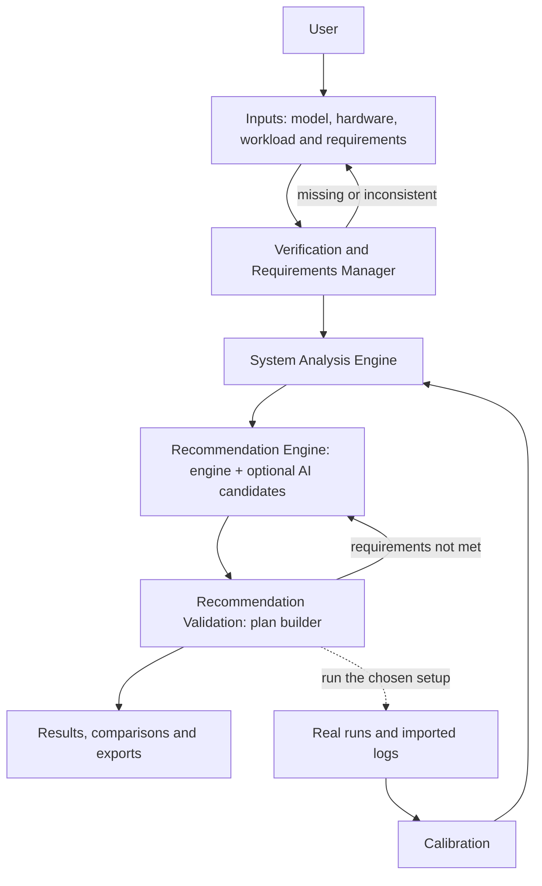

# The Green Computer: system architecture

This is the working version of `green_computer_system_architecture.md` (kept unchanged one folder
up), edited to match the code and with a status for every part: **built**, **partial** or
**planned**.

## 1. Overview

The Green Computer is a sustainability-focused AI model and hardware co-design platform, built as
an EDA-style engineering tool. It takes an AI model, hardware information and workload
requirements, verifies them, analyses how the model runs on the hardware, recommends software and
hardware changes, evaluates the ones you pick, and exports the results with a receipt. The aim is
to make the trade-offs between energy, heat, memory, speed, accuracy, cost and carbon visible
before hardware is built or bought.

## 2. Workflow

Every stage stores an immutable record. The pipeline strip at the top of each project shows each
stage as done, ready, waiting or out of date (`GET /projects/{id}/pipeline`).

## 3. Inputs and verification

### 3.1 Supported inputs

| Category | Accepted today | Planned (answered honestly, not parsed) |
|---|---|---|
| AI model | ONNX (graph, layers, tensors), library models, manual description | PyTorch `.pt`, TFLite, GGUF |
| Hardware | Library boards; device profile YAML/JSON; datasheet PDF (values confirmed by you); KiCad `.kicad_sch` / `.kicad_pcb` (structure only); Verilog / SystemVerilog (structure only); Vivado utilisation, power and timing reports; HLS csynth reports; firmware ELF (flash/RAM footprint) | VHDL, EDIF, Gerber, Allegro/OrCAD, assembly |
| Measurements | Power CSV, `nvidia-smi`, `tegrastats`, local ONNX Runtime runs, remote agent runs, Nebius GPU jobs | |
| Workload and requirements | Input rate, ambient, hours per day, grid intensity, price; limits for power, accuracy, latency, memory, throttling; enclosure and environment | |

### 3.2 Verification and Requirements Manager (built)

`GET /projects/{id}/verification` (schema `green-computer.verification/1`) checks: the model and
device exist, the cooling option belongs to the device, inputs are plausible, optional limits that
are unset, weights fit in memory at the lowest precision, the power limit against idle power and
power modes, precision support, and the result of every uploaded file's validator. Each check has a
status (pass, check, fix, note) and what to do. It never states that a design is electrically,
thermally or functionally correct; the report says so.

## 4. System Analysis Engine (built)

| Area | Output | How it is obtained |
|---|---|---|
| Energy | Energy per input, per day, split by compute, memory, idle, leakage, cooling | Analytical, calibrated or measured |
| Thermal behaviour | Steady and over-time temperature, throttling, board heat map | Lumped thermal solver; multi-node attribution; measured logs |
| Memory mapping | Peak memory, tensor lifetimes, memory timeline | ONNX graph walk |
| Compute | FLOPs, roofline position, bottleneck | Roofline model |
| Cooling techniques | Ranked cooling options with lifetime carbon; cooling sweep over ambient × load | Engine evaluation per option |
| Execution time | Latency, throughput, operator timeline | Analytical or measured |
| Accuracy | Retention by precision | **Estimated** unless measured on your data |
| Carbon footprint | kgCO2e per day and per year, operational and embodied | Engine energy × your grid intensity |
| Application requirements | Pass, fail or uncertain per requirement, with a band | Engine |
| Shortcomings | Biggest bottleneck, limiting factor, failing requirements | Engine |

Every metric carries a value, a low–high band, a unit and its provenance: measured, calibrated,
analytical (predicted), assumed. Nothing is labelled simulated unless a real simulator produced it.

Plots: interactive charts in the app; seaborn/matplotlib figures from traces (thermal board map,
warm-up, heat sources, energy, power, memory, tensor lifetimes, throughput) and from the cooling
sweep (cooling × ambient heat map, power mode × cooling heat map, 3D temperature surfaces per
cooling option); a 3D system map in the browser.

## 5. Recommendation Engine (built)

`GET /projects/{id}/recommendations` (schema `green-computer.recommendations/1`) returns records
split into **software** (code, model, runtime, execution settings) and **hardware**
(architecture, circuit, components, microarchitecture, memory, cooling, platform, chip,
application-specific). Each record has the problem, the change, why it may help, the metrics it
affects, the engine's expected effect, trade-offs, what it needs, its status, confidence, evidence
and validation state. Ranking: fixes a failing requirement first, then the project's priority.

Statuses: **recommended** (evaluated by the engine, predicted), **option** (selectable, not yet
evaluated), **directional** (analytical chip/board what-if, not a design), **guidance** (an
engineering step the engine cannot quantify; no number given), **needs input** (for example
circuit suggestions need the board file; accelerator suggestions need RTL or HLS data).

### Optional AI candidates (built; live call not yet run)

`POST /projects/{id}/recommendations/ai` sends a compact summary of the engine's analysis to the
configured OpenAI-compatible provider (Nebius Token Factory, Nemotron Super by default) and gets
JSON candidates back. The reply is validated against a schema, links to changes the engine does
not offer are removed, figures not present in the analysis are redacted, results are cached per
analysis, and every candidate is labelled "AI candidate, not evaluated" until you evaluate it.
File contents are never sent.

## 6. Validation, application and comparison (built)

The plan builder evaluates any selection of changes: baseline, each change alone, and the combined
plan, side by side with improvements and regressions. Saving a plan stores it as an immutable
version; the recommendation then shows **evaluated** or **rejected** (predicted), or **measured**
when a real run of that setup exists. Real runs: local ONNX Runtime, the remote device agent, or
Nebius GPU jobs.

Exports: engineering report (Markdown/PDF), evidence bundle, handoff zip with a hashed
`MANIFEST.json` (the change receipt), reproducibility manifest, the INT8 ONNX model (generated and
validated), configs and recipes (templates). No modified PCB or RTL is ever produced; hardware
changes are exported as instructions.

## 7. Data flow

| Stage | Consumes | Stores | Becomes out of date when |
|---|---|---|---|
| Inputs | Your edits and uploads | Project version (immutable), artifacts | – |
| Verification | Current version, artifacts | Computed on request | – |
| Analysis | Current version | Run (`runs`, kind optimise), linked to the version | The analysed inputs change (renaming does not count) |
| Recommendations | Latest analysis run | Derived; AI candidates stored per run | Its analysis is out of date |
| Validation | Selected change ids, latest run | Design plan versions | A newer analysis exists |
| Results and exports | Plans, runs, traces | Export rows with SHA-256 | – |

Nothing is deleted when you go back: earlier records are kept and marked out of date.

## 8. Design principles

Sustainability-aware, hardware-aware, evidence-driven (measured vs predicted vs assumed),
validation-first, modular, provider-independent (any OpenAI-compatible endpoint, set by
`TOKEN_FACTORY_BASE_URL`).

## 9. Status summary

| Part | Status |
|---|---|
| Verification report, pipeline status, structured recommendations, cooling sweep figures | Built and tested |
| AI candidates via Token Factory | Built and tested with a mocked provider; **live call not yet run** (needs your key) |
| Circuit, chip and microarchitecture recommendations | Directional what-ifs or "needs input"; no EDA simulation |
| Accuracy on your own data | Partial: measured retention via local INT8 comparison; no general dataset evaluator |
| Terms, privacy, consent records | Built; legal text is a **draft for professional review** |

## 10. Hackathons

**NVIDIA × Nebius:** set `TOKEN_FACTORY_API_KEY` in `.env`, run `scripts/check_nebius.py`, then
use the assistant and "Ask the AI for candidates". Each candidate request is one chat call capped
at 1,400 output tokens and cached per analysis.

**Meta (future):** point `TOKEN_FACTORY_BASE_URL` at any OpenAI-compatible Llama endpoint and set
`GC_MODEL_SUPER` (and the other tiers) to its model id. No code changes are needed.
